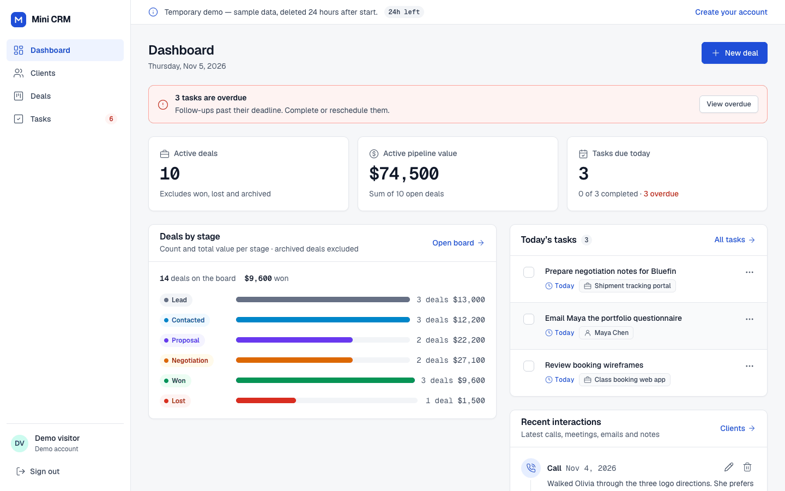
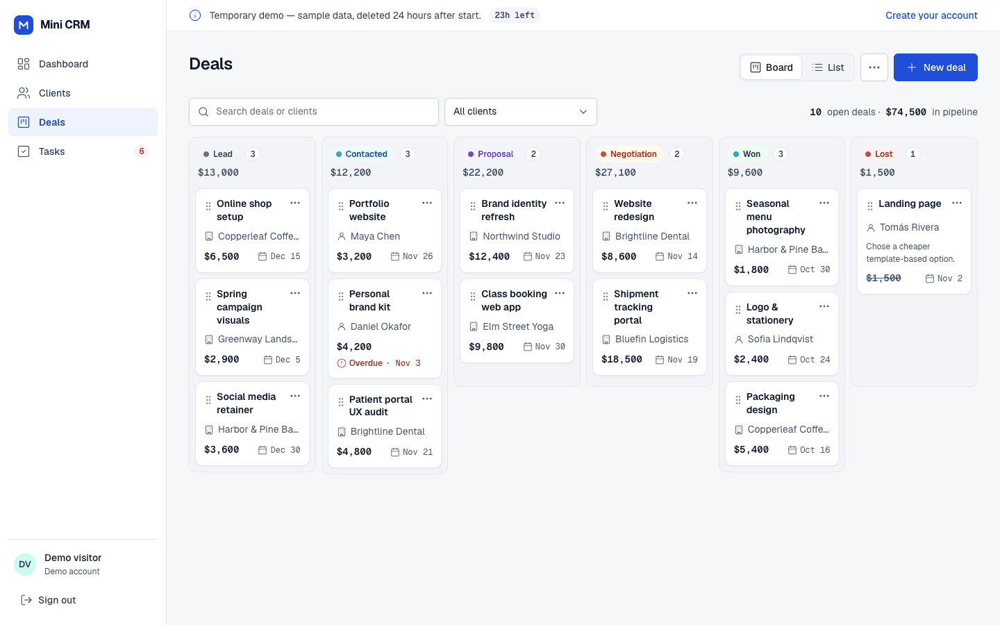
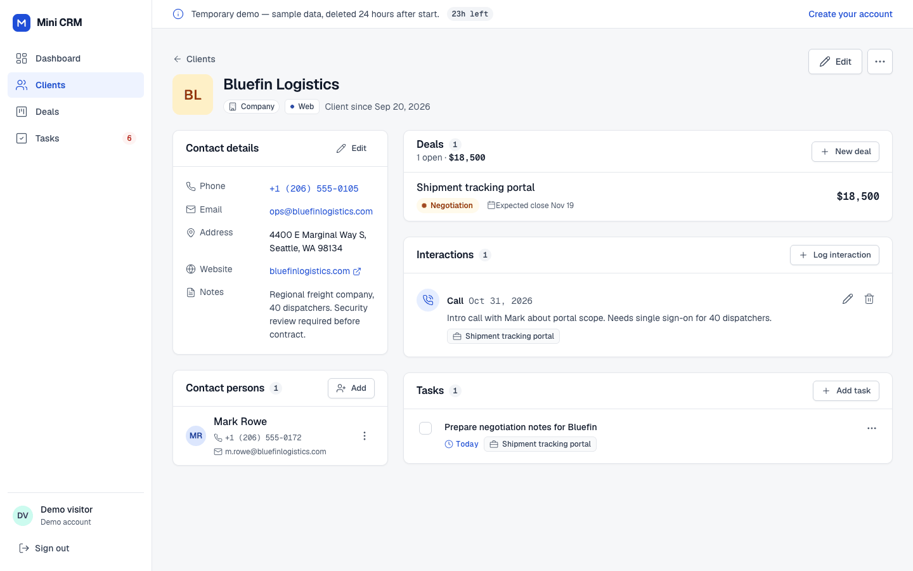
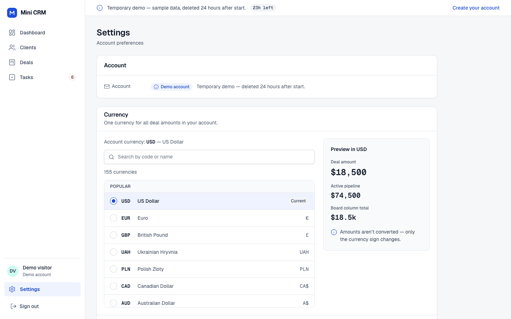
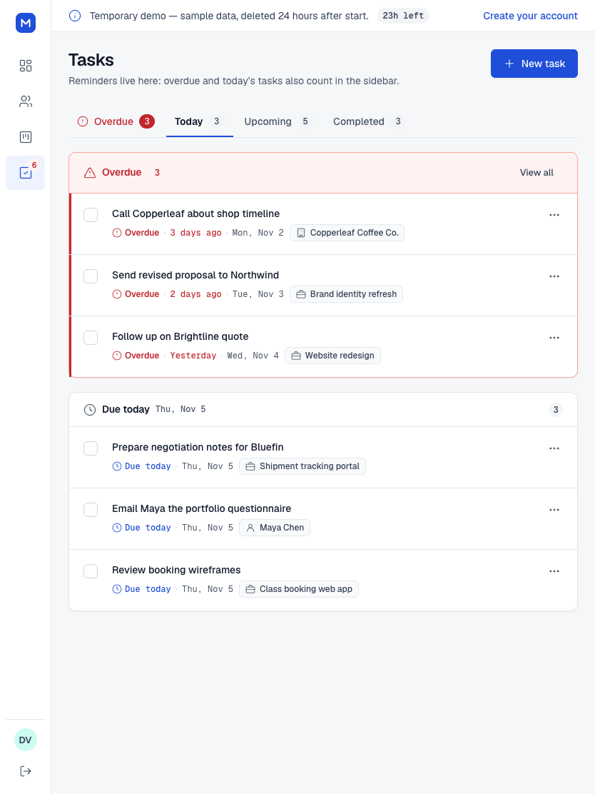
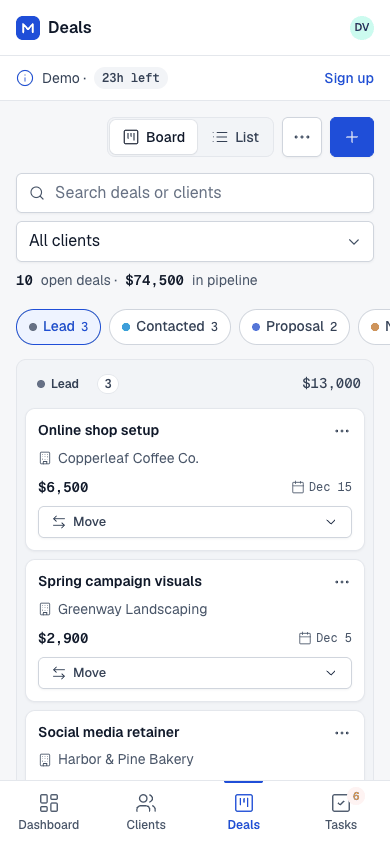
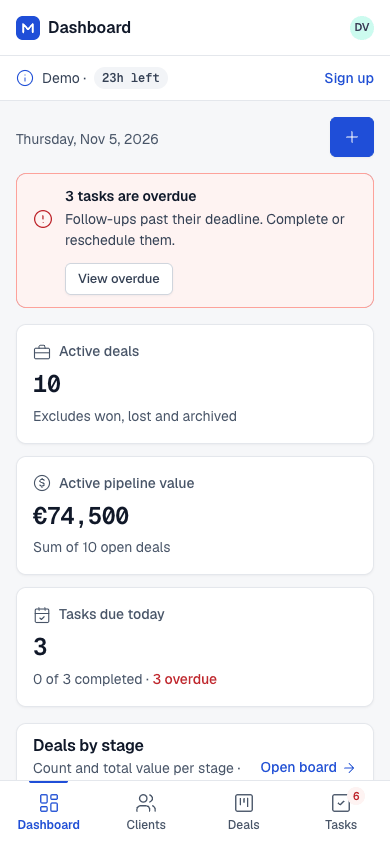

# Mini CRM

A simple CRM for freelancers and small businesses: clients and contact persons, deals on a kanban board,
interaction history, tasks with in-app reminders, a dashboard, CSV export, an account currency setting and a private
24-hour demo mode. Fully responsive: desktop (≥1024 px), tablet (768–1023 px) and mobile (<768 px).



## Features

- **Accounts** — sign up and sign in with email and password; sessions survive page reloads and server restarts.
  Every user sees only their own data.
- **Try demo** — one click starts a private, temporary demo account with realistic sample data (12 clients, 17 deals
  across all stages, interactions and tasks). Changes persist for the session; after 24 hours the demo account and
  all of its data are deleted automatically. Each new demo starts from a fresh copy.
- **Clients** — companies and people with phone, email, address, website, notes, coloured tags and contact persons;
  search by name, email or phone; filters by type and tags. Deleting a client shows exactly what will be removed
  (deals including archived ones, interactions, tasks, contact persons) and deletes it in one transaction.
- **Deals** — fixed pipeline *Lead → Contacted → Proposal → Negotiation → Won / Lost*; kanban board with drag & drop
  (persisted on the server, with Undo), an optional reason for lost deals, archive and restore, a list view with
  filters, and a deal page with its history and tasks. On mobile the board shows one stage at a time and deals move
  via a "Move to…" sheet.
- **Interactions** — calls, meetings, emails and notes linked to a client or a deal; a client's history includes the
  records of its deals.
- **Tasks** — due dates with Overdue / Today / Upcoming / Completed lists and a counter in the navigation.
  "Today" follows the browser's time zone.
- **Dashboard** — active deals and pipeline value, deals by stage, today's tasks, overdue callout, recent interactions.
- **CSV export** — clients and deals (UTF-8 with BOM, RFC 4180, protected against spreadsheet formula injection).
- **Account currency** — choose any active ISO 4217 currency in Settings; every amount in the app and in the deals
  CSV is shown in it. Amounts are not converted — only the currency sign changes.

| Deals board | Client card |
| --- | --- |
|  |  |

| Settings · currency | Tasks (tablet) | Mobile: deals | Mobile: dashboard in EUR |
| --- | --- | --- | --- |
|  |  |  |  |

## Tech stack

| Part | Technologies |
| --- | --- |
| `frontend/` | Svelte 5 (runes) + TypeScript, Vite, Vitest + Testing Library; Geist / Geist Mono fonts self-hosted via `@fontsource` |
| `backend/` | Kotlin, Spring Boot 4.1 (Web MVC, Security, Data JDBC, Validation, Actuator), Flyway, JUnit Jupiter + Testcontainers |
| Database | PostgreSQL 18 |
| `caddy/` | Caddy 2: serves the built SPA, proxies `/api/*` to the backend, automatic HTTPS when given a domain |
| `e2e/` | Browser scenarios and screenshots (playwright-core driving an installed Google Chrome) |

```
.
├── backend/src/main/kotlin/com/minicrm/
│   ├── account/       account currency (Settings), list of ISO 4217 codes
│   ├── auth/          sign-up, sign-in, cookie sessions, Try demo, rate limits
│   ├── demo/          demo sample data, cleanup of expired demo accounts
│   ├── clients/       clients, contact persons, cascading delete
│   ├── tags/ deals/ interactions/ tasks/ dashboard/ export/
│   ├── config/        Spring Security, app.* properties
│   └── common/        errors (problem+json), user time zone, rate limiter
├── backend/src/main/resources/db/migration/   Flyway migrations
├── frontend/src/
│   ├── pages/         screens (SignIn, SignUp, DemoExpired, Dashboard, Clients, ClientDetail,
│   │                  DealsBoard, DealsList, DealDetail, Tasks, Settings)
│   ├── lib/ui/        design-system components (Shell, Modal, forms, Timeline, TaskList…)
│   ├── lib/api/       HTTP client (CSRF, X-Time-Zone, problem+json), types and endpoints
│   └── styles/        ds.css (design system), screens/*.css, shared.css
├── caddy/  e2e/  docs/screenshots/
├── docker-compose.yml  .env.example
└── LICENSE
```

## Prerequisites

- JDK 25 (the Gradle wrapper downloads Gradle 9.8 itself).
- Node.js 24+ and npm.
- Docker with Docker Compose v2 (Docker Desktop, Colima or OrbStack) — for `docker compose` and integration tests.

> If your shell has `NODE_ENV=production`, npm skips devDependencies.
> Use `npm ci --include=dev` for development (or unset `NODE_ENV`).

## Environment variables

Copy `.env.example` to `.env` and set the database password. `.env` is not committed.

| Variable | Used by | Default | Purpose |
| --- | --- | --- | --- |
| `POSTGRES_DB` / `POSTGRES_USER` | compose | `minicrm` | database and user name |
| `POSTGRES_PASSWORD` | compose | — (required) | database password |
| `POSTGRES_HOST_PORT` | compose | `5433` | PostgreSQL port on host `127.0.0.1` (for running the backend outside Docker) |
| `SITE_ADDRESS` | compose → Caddy | `:80` | `:80` locally; a domain name (e.g. `crm.example.com`) to get automatic HTTPS |
| `HTTP_PORT` / `HTTPS_PORT` | compose → Caddy | `80` / `443` | published Caddy ports (`.env.example` uses `8088` / `8448` for a local machine) |
| `SERVER_PORT` | backend | `8080` | backend HTTP port |
| `DB_URL` | backend | `jdbc:postgresql://localhost:5432/minicrm` | JDBC URL |
| `DB_USERNAME` / `DB_PASSWORD` | backend | `minicrm` / `minicrm` | database credentials |
| `APP_DEMO_PER_IP_LIMIT` | backend | `10` | how many demo accounts one IP may start per hour |
| `APP_DEMO_MAX_ACTIVE` | backend | `2000` | cap on simultaneously active demo accounts |
| `APP_SESSION_TTL` | backend | `P30D` | session lifetime for registered users (ISO-8601) |
| `VITE_BACKEND_URL` | Vite dev server | `http://localhost:8080` | where the dev server proxies `/api` |

## Run with Docker Compose

```bash
cp .env.example .env          # set POSTGRES_PASSWORD
docker compose up -d --build
docker compose ps             # postgres and backend should be healthy
```

The app is at <http://localhost:8088> (or the `HTTP_PORT` you set). PostgreSQL data lives in the `postgres-data`
volume; `docker compose down -v` deletes it.

Why not 80/443 locally: Chrome may upgrade `http://` on the standard port to HTTPS automatically, while a local Caddy
with `SITE_ADDRESS=:80` does not serve HTTPS.

The configuration is suitable for a server with a domain: set `SITE_ADDRESS` to the domain and `HTTP_PORT=80`,
`HTTPS_PORT=443`, and Caddy obtains and renews the TLS certificate itself (stored in the `caddy-data` volume).
PostgreSQL is published on `127.0.0.1` only.

## Local development

```bash
# 1. PostgreSQL from compose (port 127.0.0.1:5433)
docker compose up -d postgres

# 2. Backend
cd backend
DB_URL=jdbc:postgresql://localhost:5433/minicrm DB_USERNAME=minicrm DB_PASSWORD=<password from .env> ./gradlew bootRun

# 3. Frontend (dev server with HMR, /api is proxied to the backend)
cd frontend
npm ci --include=dev
npm run dev                   # http://localhost:5173
# if the backend is not on 8080: VITE_BACKEND_URL=http://localhost:8081 npm run dev
```

Flyway applies migrations automatically when the backend starts. New migrations go to
`backend/src/main/resources/db/migration/V<N>__<description>.sql`.

## Tests and checks

```bash
# Frontend
cd frontend
npm ci --include=dev
npm test                      # Vitest: formatting, API client, components, Settings
npm run check                 # svelte-check + TypeScript
npm run build                 # production build into dist/

# Backend (unit + integration tests; Docker must be running for Testcontainers)
cd backend
./gradlew build               # compile, test, bootJar
./gradlew test --tests '*UnitTests'   # unit tests only, no Docker needed
```

Integration tests go through the real stack (HTTP → Spring Security → MVC → Data JDBC → PostgreSQL 18 in
Testcontainers) and cover authentication, data isolation between users and demo accounts, the demo lifecycle and
expiry, cascading client deletion, deals, tasks, the dashboard, CSV export and the account currency.

With **Colima**, Testcontainers does not find the Docker socket automatically — set:

```bash
export DOCKER_HOST="unix://$HOME/.colima/default/docker.sock"
export TESTCONTAINERS_DOCKER_SOCKET_OVERRIDE=/var/run/docker.sock
```

### Browser scenarios (`e2e/`)

Run against a running instance (for example Docker Compose on `http://localhost:8088`). They use playwright-core
with the installed Google Chrome.

```bash
cd e2e && npm ci --include=dev
node deals-dnd.mjs http://localhost:8088 /tmp/dnd             # drag & drop, persistence after reload, Lost reason
node deals-flows.mjs http://localhost:8088 /tmp/deals         # archive/restore, Move to…, filters, CSV
node settings-currency.mjs http://localhost:8088 /tmp/settings   # Settings, currency everywhere, persistence
node shot.mjs http://localhost:8088/ out.png 1440 900 --demo --full   # start a demo, take a screenshot
```

`sh run-evidence.sh` runs the full set of scenarios and writes screenshots to `docs/evidence/` (not committed).

## Architecture and key decisions

### Authentication and isolation
- Passwords are hashed with bcrypt (`DelegatingPasswordEncoder`), minimum 8 characters. Emails are unique
  case-insensitively.
- A session is an opaque 256-bit token in the `mcrm_session` cookie (HttpOnly, SameSite=Lax, Secure over HTTPS);
  the database stores only its SHA-256 (`user_session`). Registered users get 30 days with sliding renewal. The
  server keeps no HTTP sessions.
- CSRF: Spring Security in SPA mode — the `XSRF-TOKEN` cookie is echoed in the `X-XSRF-TOKEN` header on every
  state-changing request.
- Isolation: every row has an `owner_id`, and every query filters by the current user; other users' records return
  404. Records cannot be linked to someone else's client or deal.
- Failed sign-ins are throttled: 10 attempts per IP+email per 15 minutes → 429.

### Demo mode
- `POST /api/auth/demo` creates a separate temporary account (`app_user.demo = true`, `expires_at = now + 24h`)
  with a fresh copy of the sample data. Dates are offsets from "today" in the browser's time zone.
- Demo data behaves like normal data; reloading does not reset it. Starting a new demo creates a new account.
- After 24 hours the first request deletes the account and returns `401 demo_expired` (the "demo session has ended"
  screen); a scheduled job (`DemoCleanupJob`, every 5 minutes) removes expired demos nobody returned to. Deletion
  cascades through foreign keys `ON DELETE CASCADE` from `app_user`. Signing out of a demo deletes it immediately.
- Abuse protection: at most `APP_DEMO_PER_IP_LIMIT` (10) demos per IP per hour and a cap of `APP_DEMO_MAX_ACTIVE`
  (2000) active demos → `429`. The client IP comes from `X-Forwarded-For` set by Caddy.

### "Today"
The browser sends its IANA time zone in `X-Time-Zone` with every request; the server computes Today/Overdue, the
navigation counter and the dashboard in that zone, and the client uses the browser's local date.

### Currency
One currency per account (`app_user.currency`, ISO 4217, USD by default; every new demo starts in USD). Amounts are
stored as integers and formatted with `Intl.NumberFormat('en-US')` without minor units: $12,400 · €12,400 ·
UAH 12,400 · CA$12,400. The server accepts only active ISO 4217 codes (Bean Validation, problem+json).

### Database schema
| Table | Purpose |
| --- | --- |
| `app_user` | accounts: email + bcrypt hash, or a demo (`demo`, `expires_at`); `currency` |
| `user_session` | session token hashes; a deleted demo keeps a 7-day "tombstone" so the browser can show the expiry screen |
| `client` / `client_tag` / `tag` | clients (company/person) and the account's coloured tags |
| `contact` | a client's contact persons |
| `deal` | deals: stage `LEAD…LOST`, integer amount, expected close date, lost reason, archived flag |
| `interaction` | call/meeting/email/note; always `client_id`, plus `deal_id` when linked to a deal |
| `task` | tasks with a due date; always `client_id`, plus `deal_id` when linked to a deal |

All child tables have `ON DELETE CASCADE` foreign keys to `client` and `app_user`: deleting a client removes its deals
(including archived ones), interactions, tasks and contact persons in one transaction.

## REST API

Errors are `application/problem+json` (RFC 9457) with a `code` field; validation errors carry
`errors[{field,message}]` (one message per field). Codes: `validation_failed`, `unauthenticated`, `demo_expired`,
`csrf_invalid`, `not_found`, `email_taken`, `invalid_credentials`, `too_many_attempts`, `demo_rate_limited`,
`demo_capacity`.

| Method and path | Description |
| --- | --- |
| `GET /api/auth/csrf` | issues the `XSRF-TOKEN` cookie |
| `POST /api/auth/sign-up` · `sign-in` · `demo` · `sign-out` | account / sign in / new demo / sign out |
| `GET /api/auth/me` | current user (`demo`, `demoExpiresAt`, `currency`) |
| `PUT /api/account/currency` (`{"currency":"EUR"}`) | the caller's account currency; active ISO 4217 codes only; amounts are not converted |
| `GET/POST /api/clients` (`?q=&type=company\|person&tag=`) | list with search and filters / create |
| `GET/PUT/DELETE /api/clients/{id}`, `GET /api/clients/{id}/delete-preview` | client / update / cascading delete / what will be deleted |
| `POST /api/clients/{id}/contacts`, `PUT/DELETE /api/contacts/{id}` | contact persons |
| `GET /api/tags` | the account's tags with colours |
| `GET/POST /api/deals` (`?scope=active\|archived\|all&q=&clientId=&stage=`) | deals |
| `GET/PUT /api/deals/{id}`, `PATCH /api/deals/{id}/stage`, `POST …/archive`, `…/restore` | deal, stage change (drag & drop), archive |
| `GET/POST /api/interactions` (`?clientId=&dealId=&limit=`), `PUT/DELETE /api/interactions/{id}` | interaction history |
| `GET/POST /api/tasks`, `GET /api/tasks/summary`, `PUT/DELETE /api/tasks/{id}`, `PATCH …/done` | tasks and counters |
| `GET /api/dashboard` | KPIs, deals by stage, today's tasks, recent interactions |
| `GET /api/export/clients.csv`, `GET /api/export/deals.csv` | CSV export (amount columns labelled with the account currency) |

## License

[MIT](LICENSE) © 2026 Nestor Lozynskyi
